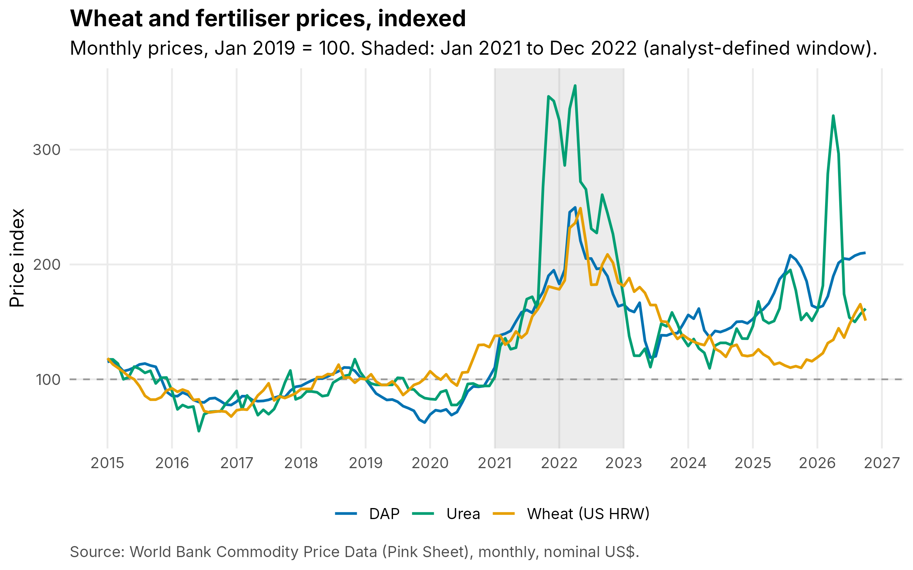
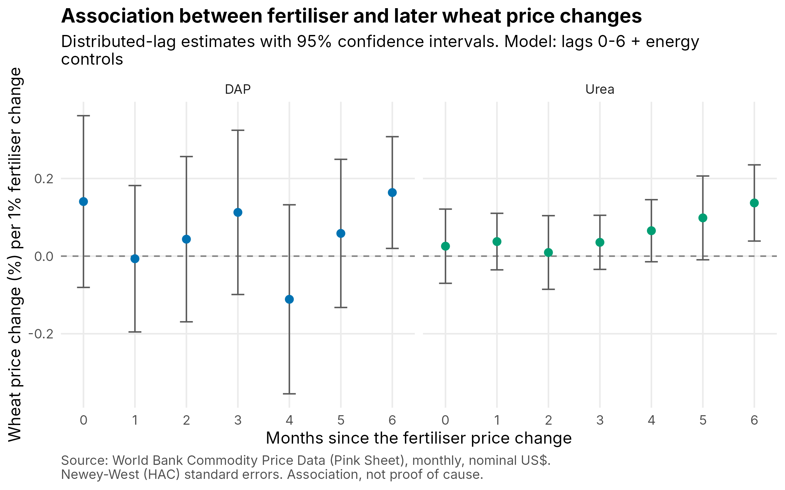

# Do fertiliser price changes show up in wheat prices later?

A time-series project in R using World Bank commodity prices from January 2015 to October 2026 (142 months). It asks whether monthly changes in fertiliser prices (DAP and urea) are followed by changes in the wheat price, and after how many months.



## Results

* Wheat prices tend to be higher about five to six months after a rise in fertiliser prices. Months 1 to 3 show little.
* Over a six-month window the total association is 0.41 for urea (95% CI 0.17 to 0.65) and 0.40 for DAP (0.02 to 0.78). In words: a one-off 1% rise in the fertiliser price goes with wheat about 0.4% higher by the end of the window.
* The urea result holds up when 2026 is dropped and when the month of the World Bank's March 2022 urea benchmark change is removed. The DAP result is weaker: its interval only just excludes zero and it depends on the model settings.
* The models explain little of wheat's month-to-month changes (adjusted R-squared 0.10 for urea, 0.04 for DAP).

| Check | Fertiliser | Total association (95% CI) |
|---|---|---|
| Main model, 6-month window | Urea | 0.41 (0.17 to 0.65) |
| Main model, 6-month window | DAP | 0.40 (0.02 to 0.78) |
| Sample ends December 2025 | Urea | 0.32 (0.08 to 0.57) |
| Sample ends December 2025 | DAP | 0.43 (0.05 to 0.81) |
| March 2022 urea benchmark change removed | Urea | 0.29 (0.07 to 0.51) |



**[View the full report](https://shrutisingla2705.github.io/fertiliser-wheat-pass-through/report.html)**, with every table and chart.

## Method

1. Prices are converted to monthly log changes (roughly monthly percentage changes), because price levels trend and can look related by accident. Stationarity is checked with ADF tests.
2. A distributed-lag regression relates the wheat change to the fertiliser change today and over the previous six months, controlling for crude oil and European gas. Standard errors are Newey-West.
3. Correlations at each delay, Granger-type tests in both directions, and robustness checks (other window lengths, with and without controls, sub-periods).

## Things to keep in mind

* This shows association, not cause. Oil and gas are controlled for. Other shocks that moved both prices, such as the 2022 war in Ukraine, are not.
* Prices are nominal US dollars and are world benchmark quotes, not what farmers pay.
* The World Bank changed some series definitions inside the sample: urea in March 2022, European gas in April 2015, and the wheat grade around mid-2020.
* The six-month window was set before the results were examined. The 12-month chart and the two sensitivity checks were added afterwards and are labelled exploratory.
* The 2021 to 2022 sub-period is too short to say whether the relationship changed.

## Run it yourself

1. Install R and RStudio, then open `fertiliser-wheat-pass-through.Rproj`.
2. Install the packages once:
   ```r
   install.packages(c("tidyverse", "readxl", "lubridate", "zoo", "sandwich",
                      "lmtest", "tseries", "scales", "rmarkdown", "knitr"))
   ```
3. Download **Monthly prices (XLS)** from <https://www.worldbank.org/en/research/commodity-markets> and save it as `data/raw/CMO-Historical-Data-Monthly.xlsx`.
4. Run `source("run_all.R")`. The charts, tables and `docs/report.html` are rebuilt.

## Files

```
R/                       the four scripts: setup, cleaning, analysis, figures
report/report.Rmd        the report template
report/interpretation_real_data.md   written interpretation of the results
run_all.R                runs everything in order
docs/report.html          the full report (open it in a browser)
output/figures/          the five charts
output/tables/           all result tables (csv)
data/raw/SOURCE.txt      where the data came from
tests/                   a check of the code on a small fake data set
```

## Tests

`tests/run_tests.R` runs the whole pipeline on a made-up workbook (clearly marked as synthetic) in which a relationship of known size is planted, and checks that the code finds it. It also checks that the cleaning code stops with a clear message when a required series is missing. Test output is written to `tests/output` and never mixed with the real results.

## Data

World Bank, Commodity Markets ("Pink Sheet"), monthly prices in nominal US dollars, file updated 3 November 2026. Check the World Bank's terms of use before redistributing the raw file, which is why it is not stored here.

Author: Shruti Singla
